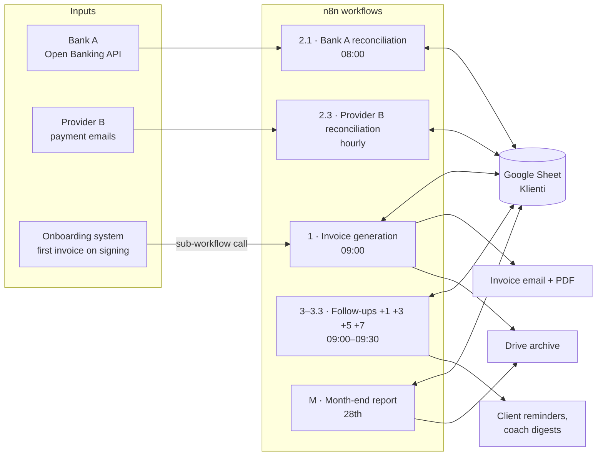

# Billing Automation · n8n

Invoicing, payment reconciliation and collections for a subscription coaching business, built as a set of small n8n workflows around one shared Google Sheet.

Built for **AK Fitness**, an online coaching business in Riga, Latvia. I handle the tech and automation side of the business.

## The problem

Dozens of clients pay a monthly subscription or a one-off consultation fee, **each on their own day of the month** (1–31), into two different payment accounts. Before this system, all of it was manual, every month:

- write each invoice and email it
- check two payment accounts for payments
- mark who has paid in a spreadsheet
- chase late payers one by one
- build a month-end overview

It took time every week, it was easy to miss a late payer, and there was no clear view of who owed what.

## What the system does

| When | Step | What happens |
|---|---|---|
| D − 7 | **Invoice** | Branded PDF generated, emailed to the client and archived in Google Drive |
| Daily | **Reconcile** | Payments matched from a bank account (Open Banking API) and a second provider (payment emails) |
| D + 1 … 7 | **Collect** | Reminder, coach alert, formal warning, suspension flag |
| 28th | **Report** | PDF summary plus a dated snapshot of the sheet |

*D = the client's own due date.* **8 workflows, 2 payment sources, 0 manual steps** in a normal paid-on-time cycle. The one manual step anywhere is pausing a client in CoachRx at day +7, because CoachRx has no public API.

## Architecture



Each workflow does one job on its own schedule and communicates with the others **only through the sheet's columns** ([schema](docs/sheet-schema.md)). That keeps each workflow small, testable on its own and safe to re-run. The one exception is onboarding, which calls Workflow 1 as a sub-workflow for a new client's first invoice, so there is only ever one invoice generator.

**Order matters:** reconciliation runs at 08:00, before the follow-ups from 09:00, so every "you haven't paid" decision uses that morning's bank data.

## The key design decision: a rolling cycle

My first version invoiced everyone on the 1st, sent reminders on the 8th and reset everything on the 28th. It passed my tests. Against real client data it failed: about half the clients pay between the 15th and the 31st, so reminders reached people whose invoice wasn't due yet, and the reset wiped clients who were mid-cycle.

It looked like three bugs, but it was one design problem: **the calendar was the wrong anchor.** Version 2 calculates every event from each client's own payment day:

- invoices go out 7 days before the client's due date
- follow-ups are relative to that due date
- each client's cycle resets when *they* are re-invoiced, not on a calendar date
- payments are reconciled every day, so per-client decisions have fresh data

```
D−7        D        +1         +3            +5          +7            +14
Invoice → Due → Reminder → Coach digest → Warning → Suspension flag → Termination
 (PDF)            client     internal       client       coach          (human decision)
          Bank A daily 08:00 · Provider B hourly — a payment stops every later step
```

## Engineering patterns

These make the system safe to run every day, unattended:

1. **Windows, not exact days.** Each follow-up stage selects clients inside a range of days past due (1–2, 3–4, 5–6, 7+). If the server is down on day 1, the reminder still goes on day 2. Windows never overlap, so a client is only ever in one stage.
2. **A flag per stage (idempotency).** After emailing a client, a stage writes today's date into its own column, and every run checks that column first. Running a workflow twice, or re-running it by hand after a failure, does nothing the second time.
3. **Timezone-safe dates.** The server runs on UTC, the business on Riga time. Every Code node computes "today" with `Intl.DateTimeFormat` in `Europe/Riga`, then does all date maths on midnight-UTC dates, so daylight saving can't move a due date.
4. **Short months handled.** Payment days 29–31 match the last day of a shorter month, so a "31st" client is still invoiced in February.
5. **Secrets outside the workflows.** The Open Banking private key and IDs are environment variables on the n8n server.

## Problems found and fixed before go-live

All found in a structured review of the live workflows, by checking what each node *actually* outputs rather than what the canvas suggests. None reached a real client.

| Problem | Cause | Fix |
|---|---|---|
| Reminders would send twice | A Gmail node replaces its items with the API response, so the next node lost the client's name and never wrote the flag | Read data from the selection node by name: `$('Node').item` |
| Late-month payments missed | The bank query started on the 1st, so on the 1st a payment made on the 31st was out of range | Rolling 40-day window, plus following the API's pagination |
| New clients never billed again | The first-invoice path wrote only a few columns, leaving the payment day empty | Write the complete client row |
| Bank API returned 401 | The JWT issuer must be the provider's domain; the app ID belongs in the key-ID header | Corrected the claims |
| Other workflows' data wiped | n8n's "update row" blanks mapped-but-empty columns | Each workflow maps only the columns it owns |

## Trade-offs I chose on purpose

- **Google Sheets, not a database.** The owners already work in Sheets and can see or correct any client's billing state; a manual fix is picked up by every workflow on its next run. At this business's size the limits don't matter. The cost is weaker integrity, handled with flags and idempotent writes.
- **Rows matched on client name.** Consistent with the existing sheet; two clients with the same name would collide. The onboarding system already generates client IDs, so switching the match key is the next step.
- **Manual CoachRx pause at +7.** CoachRx has no public API. For a step that affects a paying client's access, a clear human step beats a fragile workaround like screen-scraping.
- **One source via API, the other via email.** Each source is integrated the way it actually supports: Open Banking where available, parsed notification emails where not.

## What's in this repo

```
src/
  1-invoice/
    select-clients-due.js    who gets an invoice today (rolling cycle, short months, never twice)
    invoice-number.js        per-bank monthly counter in workflow static data
    onboarding-entry.js      sub-workflow entry used by the onboarding system
  2.1-bank-api/
    fetch-transactions.js    Enable Banking: RS256 JWT, rolling window, pagination
    match-payments.js        invoice number ↔ payment reference
  2.3-payment-emails/
    parse-payment-email.js   reference and amount from payment notification emails
  3-follow-ups/
    stage-plus5-warning.js   the shared follow-up shape: window + flag
workflows/
  3.2-plus5-warning.json     one complete workflow export, importable into n8n
docs/
  sheet-schema.md            the shared sheet's columns and rules
```

The `src/` files are the JavaScript from the workflows' Code nodes, with English comments added. Node names referenced in them are translated; in the live workflows they are in Latvian. Everything identifying has been removed: client data, client numbers, which banks are used, bank details, sheet and Drive IDs, email addresses and credentials. Placeholders like `YOUR_SPREADSHEET_ID` mark where your own values go, and the two payment sources are called `BANK_A` (Open Banking) and `BANK_B` (email notifications).

## Stack

n8n (self-hosted) · JavaScript in Code nodes · Google Sheets · Gmail · Google Drive · Enable Banking (PSD2 Open Banking) · HTML-to-PDF API

Built with Claude connected to the live n8n instance through n8n's MCP server. I made the design decisions and checked every change against the live instance.

## Status and next steps

Invoicing passed a live end-to-end test to a test inbox, and the bank connection is tested. The follow-up ladder is waiting on a full dry run (test rows forced through +1, +3, +5 and +7, then each stage re-run to prove it doesn't fire twice) before the system goes live.

Next:
- stable client IDs as the match key
- an n8n error workflow that alerts me when any run fails
- an append-only invoice ledger, so reporting doesn't depend on monthly snapshots
- check the paid amount against the invoice amount, to catch partial payments
